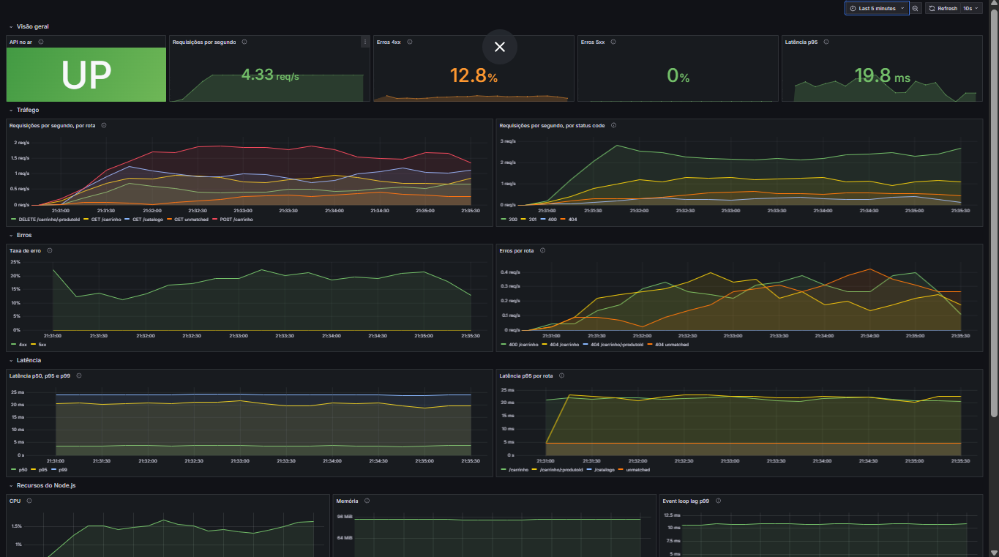
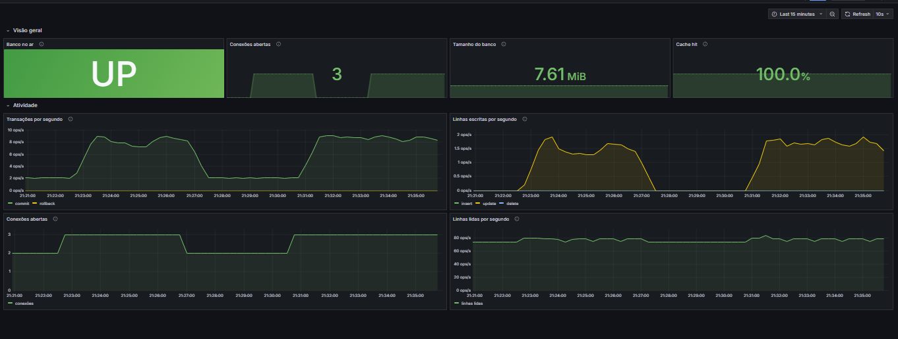

# Observabilidade

Estrutura de monitoramento da API do carrinho: a API e o banco expõem métricas, o **Prometheus** coleta e guarda o histórico, e o **Grafana** mostra tudo em dashboards.

```
 api  (/metrics)  ─────────────┐
                               ├──►  Prometheus  ──►  Grafana
 db  ◄── postgres-exporter ────┘     (coleta a        (dashboards)
         (:9187/metrics)              cada 15s)
```

Todos os serviços rodam na mesma rede do Docker Compose e se encontram pelo nome do serviço (`api`, `postgres-exporter`, `prometheus`).

## Conteúdo da pasta

```
config/observability/
├── compose.yaml                         # serviços prometheus, postgres-exporter e grafana
├── prometheus/prometheus.yml            # alvos coletados pelo Prometheus
├── grafana/
│   ├── provisioning/datasources/        # conecta o Grafana ao Prometheus automaticamente
│   ├── provisioning/dashboards/         # carrega os dashboards desta pasta ao subir
│   └── dashboards/                      # dashboards em JSON (versionados no Git)
└── prints/                              # evidências dos dashboards funcionando
```

Os dashboards são **provisionados como código**: o Grafana sobe já com a fonte de dados e os dashboards configurados, em qualquer máquina, sem nenhum clique.

## Como rodar

Na raiz do repositório:

```bash
cp .env.example .env
docker compose up -d --build
```

| Serviço    | Endereço                        | Acesso                                     |
| ---------- | ------------------------------- | ------------------------------------------ |
| Grafana    | `http://localhost:3001`         | `admin` / `GRAFANA_ADMIN_PASSWORD` do .env |
| Prometheus | `http://localhost:9090`         | sem login                                  |
| Alvos      | `http://localhost:9090/targets` | `api` e `postgres` precisam estar **UP**   |
| Métricas   | `http://localhost:3000/metrics` | saída bruta da API                         |

No Grafana, os dashboards ficam em **Dashboards → git_workflow**.

## Dashboard "API do Carrinho"

Organizado pelos **quatro sinais de ouro** do monitoramento (tráfego, erros, latência e saturação), mais uma linha de negócio.

| Linha               | Painel                           | O que mostra e por que importa                                                                             |
| ------------------- | -------------------------------- | ---------------------------------------------------------------------------------------------------------- |
| Visão geral         | API no ar                        | Se o Prometheus consegue coletar a API. É o primeiro sinal de queda                                        |
| Visão geral         | Requisições por segundo          | Volume total de uso da API                                                                                 |
| Visão geral         | Erros 4xx / Erros 5xx            | Fração de respostas com erro do cliente e do servidor                                                      |
| Visão geral         | Latência p95                     | Tempo em que 95% das requisições respondem                                                                 |
| Tráfego             | Requisições por rota             | Quais endpoints são mais usados                                                                            |
| Tráfego             | Requisições por status code      | Distribuição entre sucesso (2xx), erro do cliente (4xx) e do servidor (5xx)                                |
| Erros               | Taxa de erro                     | Evolução de 4xx e 5xx. 5xx é falha da API; 4xx em excesso indica clientes usando a API errado              |
| Erros               | Erros por rota                   | Em qual endpoint os erros acontecem                                                                        |
| Latência            | p50, p95 e p99                   | p50 é o caso típico; p95 e p99 mostram os casos lentos que a média esconde                                 |
| Latência            | p95 por rota                     | Qual endpoint é o mais lento                                                                               |
| Recursos do Node.js | CPU                              | Uso de CPU do processo (100% = um núcleo)                                                                  |
| Recursos do Node.js | Memória                          | Memória total do processo e a usada pelos objetos JavaScript (heap). Crescimento contínuo indica vazamento |
| Recursos do Node.js | Event loop lag                   | Atraso do event loop. Se cresce, o Node não dá conta de atender novas requisições                          |
| Negócio             | Unidades adicionadas por produto | Quais produtos mais entram no carrinho no período                                                          |
| Negócio             | Unidades adicionadas por minuto  | Ritmo de adição de cada produto                                                                            |

## Dashboard "Banco de Dados (PostgreSQL)"

| Painel                      | O que mostra e por que importa                                                                        |
| --------------------------- | ----------------------------------------------------------------------------------------------------- |
| Banco no ar                 | Se o exporter consegue conectar ao PostgreSQL                                                         |
| Conexões abertas            | Conexões ativas. O Sequelize mantém um pool, então o número deve ficar estável                        |
| Tamanho do banco            | Espaço ocupado em disco                                                                               |
| Cache hit                   | Fração das leituras atendidas pela memória, sem ir ao disco. Abaixo de 99% começa a indicar lentidão  |
| Transações por segundo      | Commits e rollbacks. Rollbacks frequentes indicam operações falhando                                  |
| Linhas escritas por segundo | Inserts, updates e deletes. Mostra a API agindo no banco: cada POST e DELETE do carrinho aparece aqui |
| Linhas lidas por segundo    | Leituras feitas pelas consultas de catálogo e carrinho                                                |

## Métricas expostas pela API

Definidas em [`src/metrics.js`](../../src/metrics.js), com a biblioteca `prom-client`.

| Métrica                            | Tipo      | Labels                           | Descrição                                         |
| ---------------------------------- | --------- | -------------------------------- | ------------------------------------------------- |
| `http_requests_total`              | Counter   | `method`, `route`, `status_code` | Total de requisições atendidas                    |
| `http_request_duration_seconds`    | Histogram | `method`, `route`, `status_code` | Distribuição do tempo de resposta                 |
| `carrinho_itens_adicionados_total` | Counter   | `produto`                        | Unidades adicionadas ao carrinho (negócio)        |
| `process_*` e `nodejs_*`           | vários    |                                  | Métricas padrão do Node: CPU, memória, event loop |

**Decisões que valem destacar:**

- **O label `route` usa o padrão da rota** (`/carrinho/:produtoId`), e não a URL real (`/carrinho/2`). Com a URL, cada id criaria uma série nova no Prometheus, e o número de séries cresceria sem limite.
- **Rotas inexistentes viram `unmatched`**, pelo mesmo motivo: qualquer URL digitada errada criaria uma série nova.
- **O próprio `/metrics` não é contado.** O Prometheus chama esse endpoint a cada 15 segundos, e isso não é tráfego de usuário.
- **Os buckets do histograma começam em 5 ms**, porque esta API responde em poucos milissegundos. Com buckets maiores, o p95 calculado seria impreciso.

## Roteiro de demonstração

1. Subir o ambiente e abrir `http://localhost:9090/targets` para mostrar os alvos **UP**.
2. Em outro terminal, gerar tráfego por 5 minutos:
   ```bash
   ./scripts/carga.sh 300
   ```
   O script mistura requisições normais com erros propositais (400 e 404).
3. Abrir o dashboard **API do Carrinho** e percorrer as linhas: tráfego, erros, latência, recursos e negócio.
4. Abrir o dashboard **Banco de Dados** e mostrar as linhas escritas acompanhando os POSTs e DELETEs do script.
5. Simular uma falha parando o banco:
   ```bash
   docker compose stop db
   ```
   Em até 30 segundos, **Banco no ar** fica vermelho, o painel de **Erros 5xx** sobe e o `/health` da API passa a responder 503.
6. Religar com `docker compose start db` e mostrar os painéis voltando ao normal.

## Evidências




